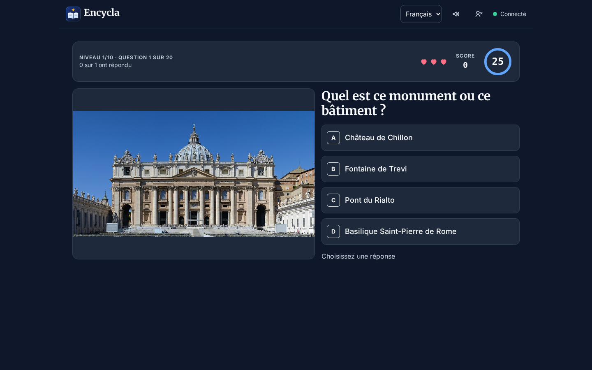
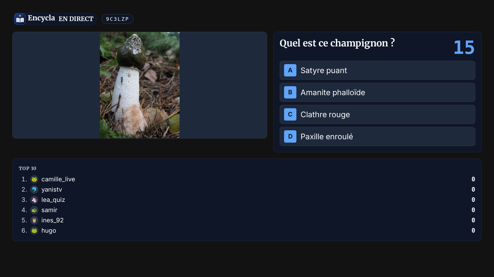
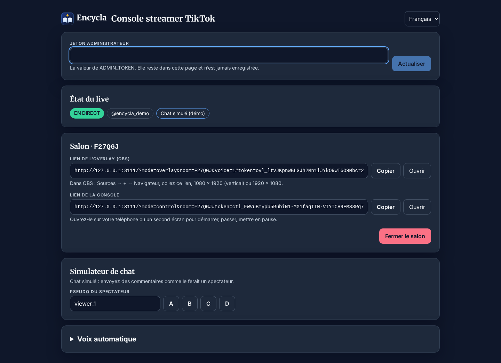

<p align="center">
  
</p>

<p align="center">
  <strong>The visual encyclopedia game.</strong> Identify the subject of the photo, answer before the timer, then read the story behind the image.
</p>

<p align="center">
  <a href="https://github.com/polbotweb/encycla/actions/workflows/ci.yml"></a>
  
  
</p>

<p align="center"><a href="README.md">Version française (complète)</a></p>

> This is a condensed English guide. The French [README.md](README.md) is the complete reference, and the detailed documentation in [docs/](docs/) is written in French.



## What it is

Encycla MindMaze is a real-time multiplayer picture quiz. Each question shows a real Wikimedia Commons photo with four answers; after each question the matching Wikipedia article is shown.

- **2,605 questions** in **18 categories**, all generated from Wikipedia, Wikidata and Wikimedia Commons (author, licence and revision permalink for each). No invented content.
- **French (default), English and Arabic** (right-to-left).
- **Without TikTok**: solo, private rooms, public matchmaking, on desktop and mobile.
- **With TikTok Live**: viewers of **any live** answer `A`, `B`, `C` or `D` in the chat; OBS overlay and streamer consoles.
- **Automatic voice**: the browser's own speech synthesis reads the question, A/B/C/D, the time left and the correct answer in the question language. On by default on the TikTok overlay and console, off by default for players (header button). No voice for the language on the device: a notice, never another language's voice. OBS setup: [docs/TIKTOK.md](docs/TIKTOK.md#voix-automatique-et-obs-d-115).
- **Server-authoritative**: scores, timing and lives are computed on the server; the correct answer is never sent before the reveal.

## Game modes

|                    | CLASSIC   | SUBJECT   | CONTEST   |
| ------------------ | --------- | --------- | --------- |
| Levels × questions | 10 × 20   | 1 × 20    | 1 × 10    |
| Web players        | 1–8       | 1–8       | exactly 2 |
| TikTok viewers     | up to 100 | up to 100 | —         |
| Lives              | 3         | 3         | none      |

- **Solo**, **private room** (6-character code or `/?mode=join&code=…` link, 2–8 players), **public matchmaking** (by mode, category, difficulty and question language; duels start at 2 players).
- **TikTok**: the streamer console `/?mode=admin` creates a room for any live and gives the **overlay** link (OBS browser source, 1080×1920 or 1920×1080) and the **control** link (start, pause, skip, manual answer, close). `TIKTOK_ADAPTER=fake` gives a simulated chat for rehearsals and tests. Guide: [docs/TIKTOK.md](docs/TIKTOK.md).

| TikTok overlay                                                      | Streamer console                                                  |
| ------------------------------------------------------------------- | ----------------------------------------------------------------- |
|  |  |

## Player guide

Pick a language (top right), type a nickname (no account), choose solo / private room / play online, then answer by clicking, tapping, or with `A`–`D` / `1`–`4`. `M` mutes, `Esc` leaves. After each question: the answer, your points and the article. The global leaderboard ranks multiplayer and TikTok games (solo is not ranked).

## Hosting

```bash
git clone https://github.com/polbotweb/encycla.git && cd encycla
cp .env.example .env    # NODE_ENV=production, PUBLIC_ORIGIN=https://<domain>, ADMIN_TOKEN=$(openssl rand -hex 32), DOMAIN, TRUST_PROXY=true
docker compose --profile proxy up -d --build   # app + Caddy (automatic HTTPS)
curl -s https://<domain>/api/health
```

Single instance only (rooms are in memory), a persistent volume for SQLite, WebSockets enabled. The server refuses to start in production with a missing/weak `ADMIN_TOKEN`, a non-https `PUBLIC_ORIGIN` or `RATE_LIMIT=off`. All variables: README §8 and [docs/DEPLOYMENT.md](docs/DEPLOYMENT.md). TikTok (optional, unofficial AGPL connector): `TIKTOK_ENABLED=true`, a dedicated account cookie, image built with `WITH_TIKTOK=true`.

## Developers

```bash
pnpm install --frozen-lockfile && cp .env.example .env
pnpm dev                 # client :5173 + server :3000
pnpm lint && pnpm typecheck && pnpm test:coverage && pnpm build
pnpm test:e2e            # Playwright: desktop, Pixel 7, iPhone 14, TikTok (simulated chat)
pnpm docs:screenshots    # regenerate docs/screenshots from the built app
```

Stack: TypeScript strict, Express 5, Socket.io, React 19, Zustand, Tailwind, SQLite, Vitest, Playwright. Architecture, socket protocol, data model, adding a language or category: README §11–12, [docs/PROTOCOL.md](docs/PROTOCOL.md), [docs/DATA-MODEL.md](docs/DATA-MODEL.md).

## Content editors

Only French Wikipedia article **titles** are chosen by hand (`scripts/wikimedia/seeds/`). `pnpm data:wikipedia` fetches everything else (answer, article, image, author, licence, translations), `data/sources/report.json` lists what was rejected, `pnpm data:validate` checks the bank. Translations use the real name in the language, else the scientific name, else the original name, else the question is not offered in that language — never a French fallback.

## Licences

Code: [MIT](LICENSE). Texts: Wikipedia, CC BY-SA 4.0; Wikidata labels CC0. Images: Wikimedia Commons, per-file free licences, credited ([CREDITS.md](CREDITS.md)). Fonts: SIL OFL. Optional TikTok connector: AGPL-3.0-only, not in the default image. Details: [docs/LICENSES.md](docs/LICENSES.md).
