<p align="center">
  
</p>

<p align="center">
  <strong>Le jeu de l'encyclopédie visuelle.</strong> Identifiez le sujet de la photo, répondez avant la fin du temps, puis lisez l'histoire derrière l'image.
</p>

<p align="center">
  <a href="https://github.com/polbotweb/encycla/actions/workflows/ci.yml"></a>
  
  
  
  
</p>

<p align="center"><a href="README.en.md">English version</a></p>

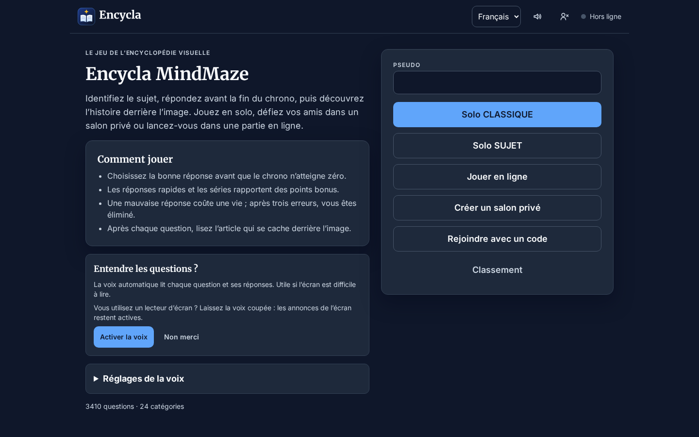

---

## Sommaire

1. [Présentation](#1-présentation)
2. [Fonctionnalités](#2-fonctionnalités)
3. [Modes de jeu](#3-modes-de-jeu)
4. [Guide du joueur](#4-guide-du-joueur)
5. [Guide du streamer TikTok](#5-guide-du-streamer-tiktok)
6. [Langues](#6-langues)
7. [Guide de l'hébergeur / administrateur](#7-guide-de-lhébergeur--administrateur)
8. [Configuration (`.env`)](#8-configuration-env)
9. [Déploiement](#9-déploiement)
10. [Sécurité et anti-triche](#10-sécurité-et-anti-triche)
11. [Tutoriel développeur](#11-tutoriel-développeur)
12. [Guide du rédacteur de contenu](#12-guide-du-rédacteur-de-contenu)
13. [Tests et CI](#13-tests-et-ci)
14. [FAQ et dépannage](#14-faq-et-dépannage)
15. [Contribuer](#15-contribuer)
16. [Documentation détaillée](#16-documentation-détaillée)
17. [Licences et crédits](#17-licences-et-crédits)

---

## 1. Présentation

**Encycla MindMaze** est un quiz visuel multijoueur en temps réel. Chaque question montre une vraie photo de Wikimedia Commons (un animal, un drapeau, un monument, une planète, un plat…) et propose quatre réponses. Après chaque question, l'article Wikipédia correspondant s'affiche : on joue, puis on apprend.

- **3 410 questions** dans **24 catégories** (dont Chiens, Chats, Monuments arabes et islamiques, Plats du monde, Villes, Peintres), toutes générées depuis Wikipédia, Wikidata et Wikimedia Commons, avec auteur, licence et permalien de révision ; aucun contenu inventé.
- **Trois langues** : français (par défaut), anglais et arabe (mise en page de droite à gauche).
- **Sans TikTok** : solo, salon privé, matchmaking public, sur ordinateur et sur mobile.
- **Avec TikTok Live** : les spectateurs de **n'importe quel live** répondent `A`, `B`, `C` ou `D` dans le chat, avec un overlay pour OBS et une console pour le streamer.
- **Le serveur fait foi** : score, temps, vies et bonne réponse sont calculés côté serveur. La bonne réponse n'est jamais envoyée avant la révélation.

Principes d'architecture :

1. Le serveur est la seule source de vérité. Le client envoie des intentions et affiche des instantanés.
2. Toute partie est un salon (*room*). Le solo est un salon à un joueur, le duel un salon à deux.
3. Les règles sont déterministes et testables : le moteur est un réducteur pur, avec horloge, aléatoire et banque de questions injectés.
4. Aucun secret ni aucune réponse dans le client.

## 2. Fonctionnalités

| Domaine | Ce qui est fourni |
| --- | --- |
| Jeu | CLASSIC (10 niveaux de 20 questions), SUBJECT (une catégorie, 20 questions), CONTEST (duel de 10 questions), vies, séries, bonus de vitesse, article après chaque question. |
| Multijoueur | Salons privés à code (2 à 8 joueurs), matchmaking public par mode/catégorie/difficulté/langue, vote « petit salon » après 2 minutes, reconnexion transparente. |
| TikTok | Room TikTok pour n'importe quel live, jusqu'à 100 spectateurs, parseur strict des commentaires, overlay OBS en lecture seule, console de jeu, console streamer `/?mode=admin`, chat simulé pour les démos. |
| Classement | Classement global (multijoueur et TikTok ; le solo n'est pas classé), filtres par mode et par source. |
| Contenu | Banque Wikipédia/Commons/Wikidata, crédits par image, licences libres uniquement, traductions réelles ou question retirée de la langue. |
| Interface | React 19, thème sombre AA, clavier (`A`–`D`, `1`–`4`, `M` pour le son, `Échap` pour quitter), annonces lecteur d'écran, voix automatique (synthèse vocale du navigateur, fr/en/ar), sons synthétisés, PWA (manifeste, icônes *maskable*). |
| Images | Proxy same-origin `/img` : aucun nom de fichier ni crédit avant la révélation, métadonnées retirées, cache disque plafonné. |
| Exploitation | Docker non-root, Caddy HTTPS, SQLite avec repli mémoire, validation de configuration *fail-fast*, sondes `/healthz` et `/readyz`, métriques Prometheus `/metrics` (admin), logs JSON, sauvegardes SQLite à chaud vérifiées et tournantes. |
| Qualité | TypeScript strict, 510 tests Vitest, 59 tests Playwright (bureau, Pixel 7, iPhone 14, TikTok simulé, voix), build et démarrage vérifiés sans le paquet TikTok, test de charge, `pnpm audit` sans vulnérabilité, CI complète. |

## 3. Modes de jeu

| | CLASSIC | SUBJECT | CONTEST |
| --- | --- | --- | --- |
| Niveaux | 10 | 1 | 1 |
| Questions | 20 par niveau | 20 | 10 |
| Joueurs web | 1 à 8 | 1 à 8 | exactement 2 |
| Joueurs TikTok | jusqu'à 100 | jusqu'à 100 | non proposé |
| Catégories | toutes | une seule, choisie | toutes |
| Vies | 3 (rechargées à chaque niveau en solo) | 3 | aucune |
| Difficulté | progressive (Novice → Adventurer → Wizard) | choisie | Adventurer |
| Article | après chaque question | après chaque question | après chaque question |

### 3.1 Sans TikTok (web, ordinateur et mobile)

C'est le jeu complet ; TikTok est désactivé par défaut (`TIKTOK_ENABLED=false`) et n'apparaît nulle part.

- **Solo** : « Solo CLASSIC » ou « Solo SUBJECT » sur l'accueil. On joue seul ; la partie se termine à la perte des trois vies ou à la fin du dernier niveau.
- **Salon privé** : « Créer un salon privé » donne un code à 6 caractères et un lien `/?mode=join&code=…`. Les invités le rejoignent, chacun se déclare prêt, l'hôte lance la partie. L'hôte peut passer un article pour tout le monde.
- **Matchmaking public** : « Jouer en ligne ». Les joueurs sont regroupés par mode, catégorie, difficulté et langue des questions. CONTEST démarre dès 2 joueurs ; CLASSIC et SUBJECT visent 4 joueurs et proposent un vote « petit salon » (2 à 3 joueurs) après 2 minutes d'attente.
- **SUBJECT / catégories** : une catégorie n'est proposée que si elle compte au moins 100 questions dans la langue choisie (23 des 24 catégories le dépassent dans les trois langues ; **Chats** reste en dessous — 81 questions, 74 en arabe — car Wikipédia en français ne compte qu'environ 85 races de chat illustrées : la catégorie sert en partie CLASSIC, sans contenu inventé).

### 3.2 Avec TikTok Live (n'importe quel live)

`TIKTOK_ENABLED=true`. Le streamer crée une room depuis la console `/?mode=admin` pour le `@` de son live, met l'overlay dans OBS et pilote la partie depuis la console de jeu. Les spectateurs répondent `A`, `B`, `C` ou `D` dans le chat. Voir le [guide du streamer](#5-guide-du-streamer-tiktok).

| Overlay OBS (1920 × 1080) | Console de jeu |
| --- | --- |
| 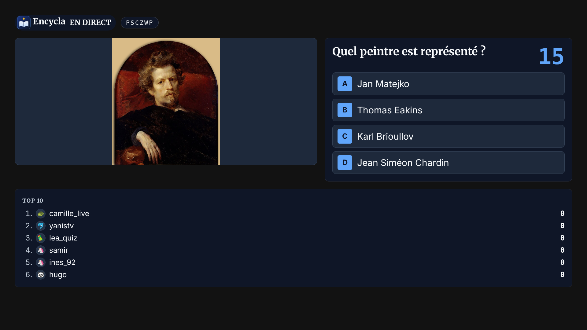 | 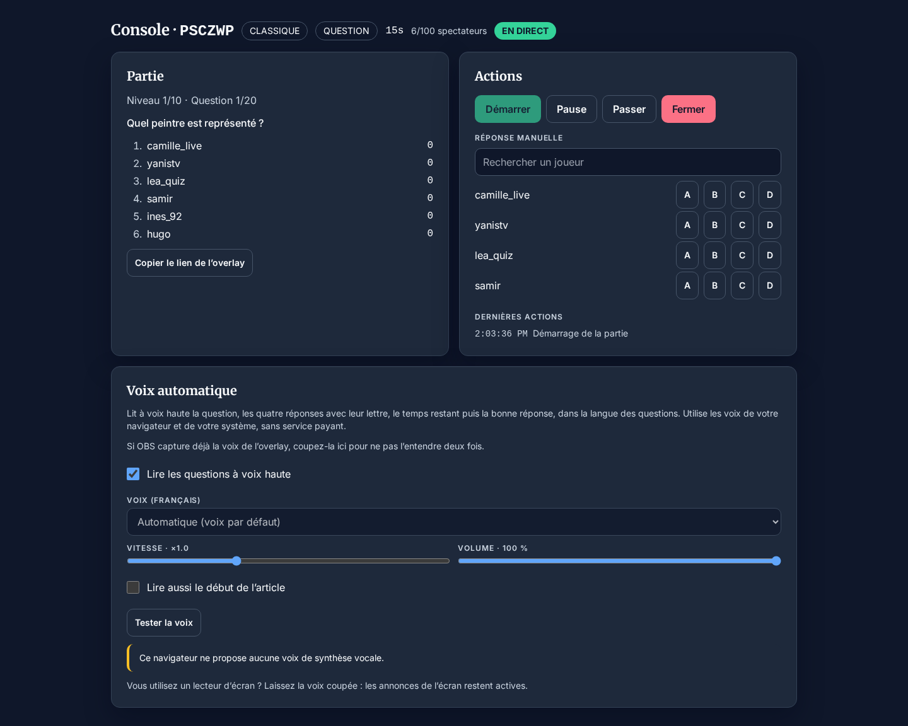 |

Le navigateur sans tête qui a pris ces captures n'a aucune voix installée : la console affiche donc l'avis « Ce navigateur ne propose aucune voix de synthèse vocale ». Sur un ordinateur avec des voix, la liste « Voix (français) » les propose.

Les deux modes sont vérifiés de bout en bout par Playwright contre le serveur construit : voir [Tests et CI](#13-tests-et-ci).

## 4. Guide du joueur

1. **Ouvrir le jeu** et choisir sa langue en haut à droite (Français, English, العربية).
2. **Saisir un pseudo** (2 à 24 caractères). Aucun compte, aucun e-mail : une session anonyme est créée.
3. **Choisir comment jouer** : solo, salon privé, rejoindre avec un code, ou jouer en ligne.
4. **Régler la partie** : mode, langue des questions, et pour SUBJECT la catégorie et la difficulté.

   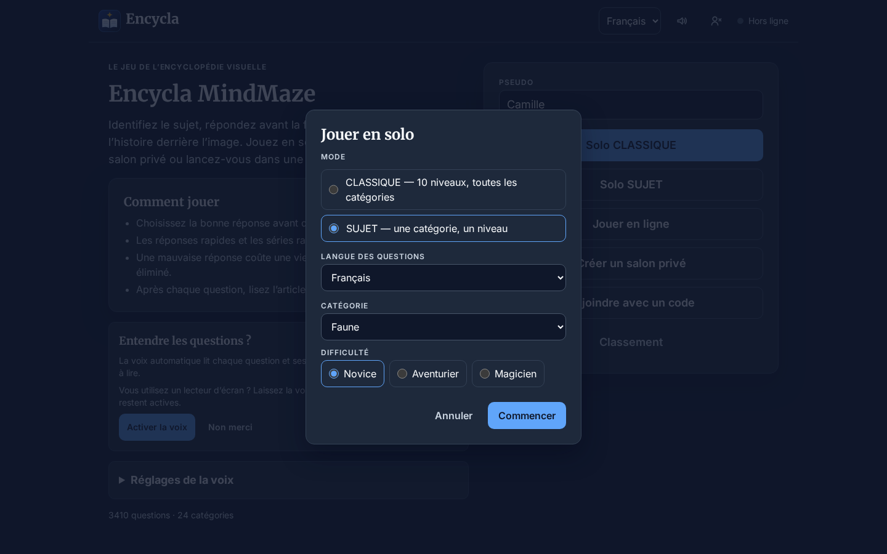

5. **Répondre** : cliquer, toucher l'écran, ou taper `A`–`D` / `1`–`4`. Le chronomètre est celui du serveur.

   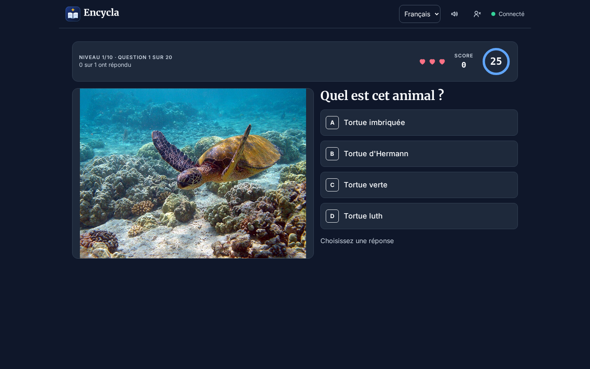

6. **Révélation** : la bonne réponse, vos points (+ bonus de vitesse et de série), vos vies.

   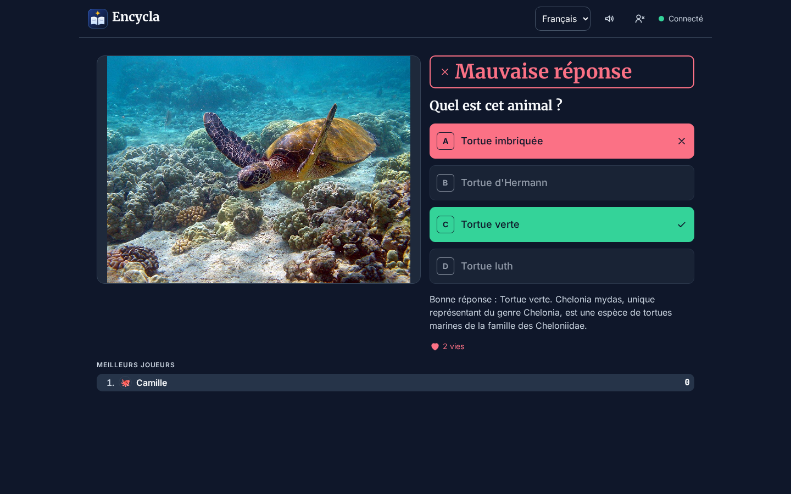

7. **Article** : le résumé de l'article Wikipédia, le crédit de la photo et le lien vers l'article. « Continuer » quand vous êtes prêt (la suite démarre automatiquement sinon).

   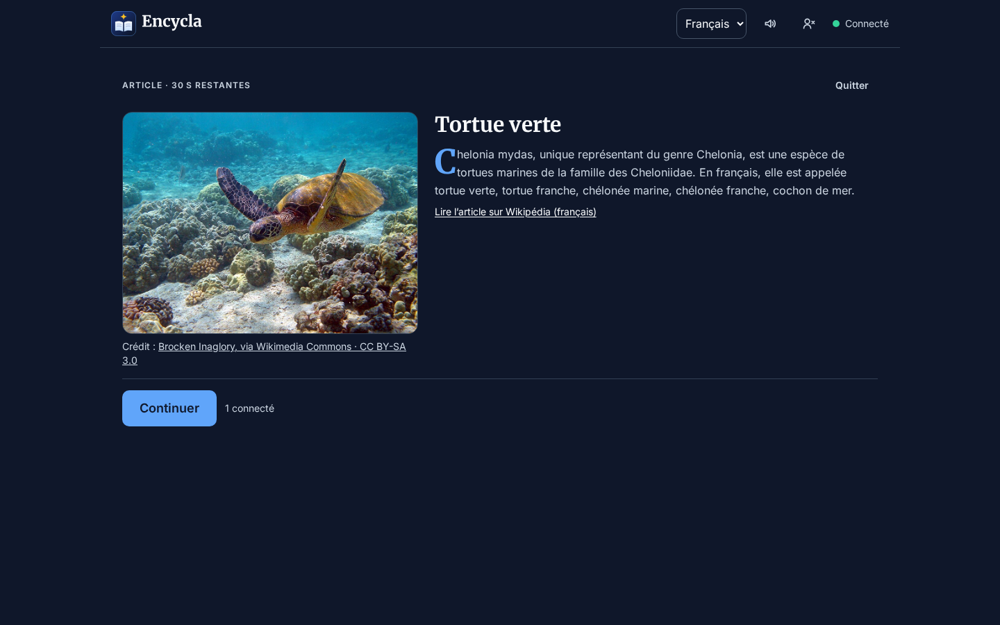

8. **Résultats** : podium et classement final ; « Classement » pour le classement global.

| Résultats d'un duel | Classement global |
| --- | --- |
| 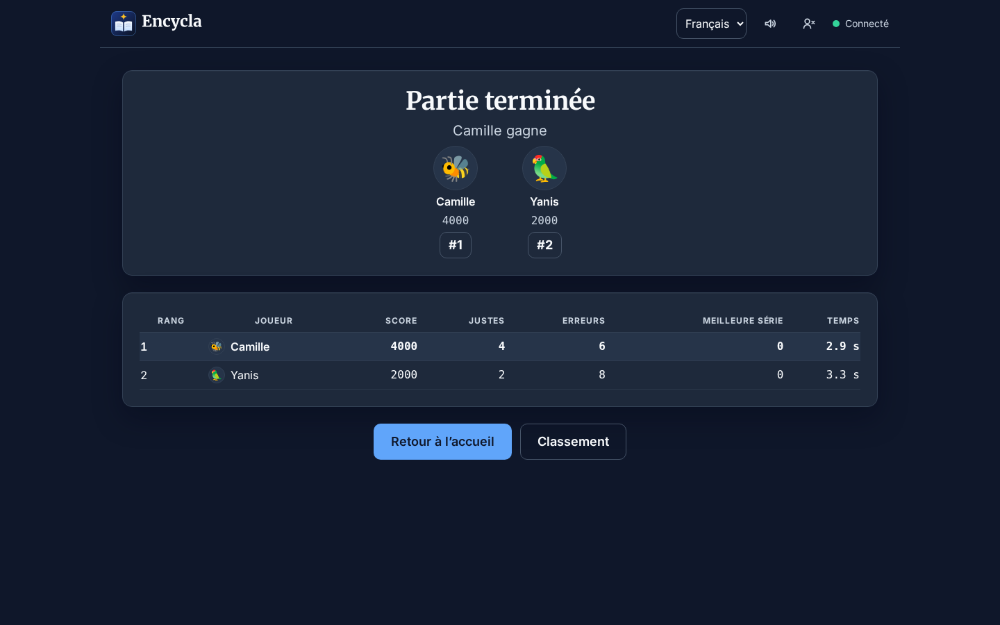 | 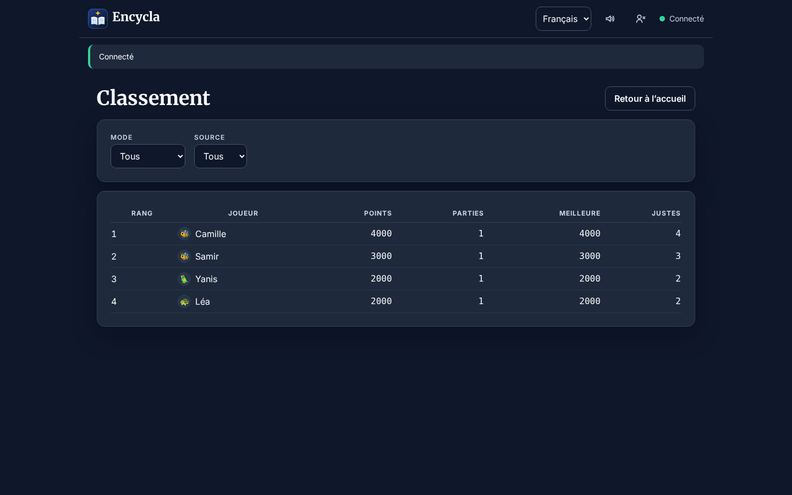 |

| Salon privé (lobby) | Matchmaking public |
| --- | --- |
| 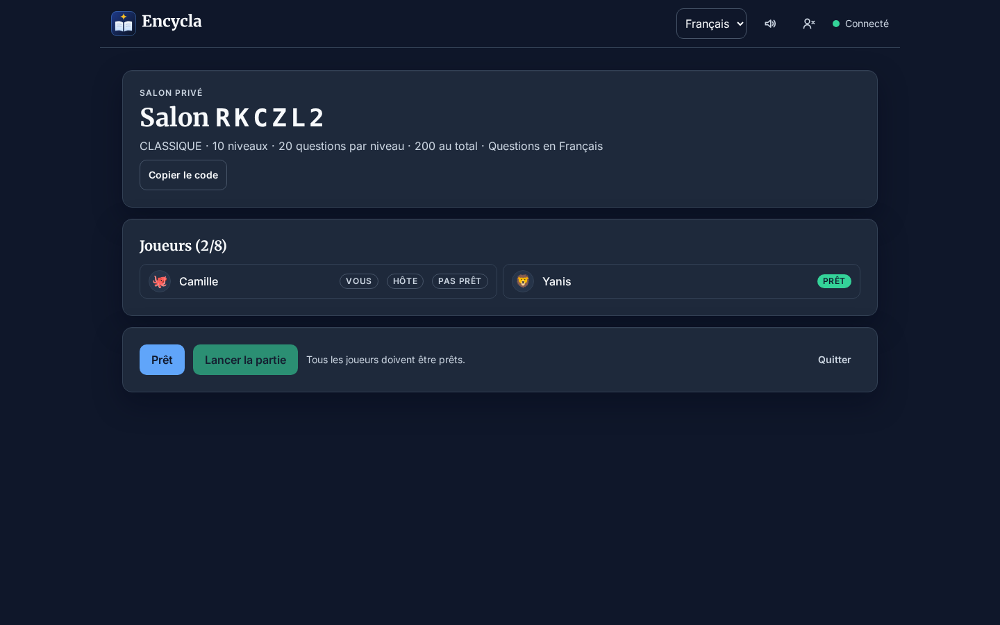 | 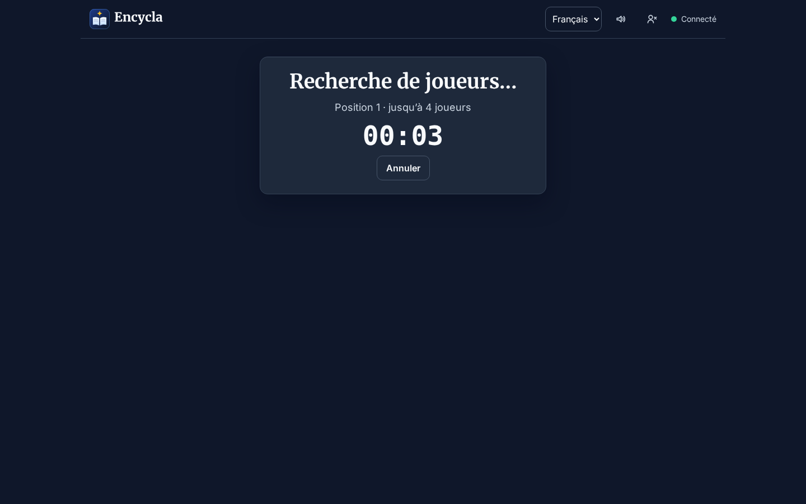 |

**Sur mobile**, tout fonctionne au toucher, sans défilement horizontal :

| Accueil | Question | Article | Résultats |
| --- | --- | --- | --- |
| 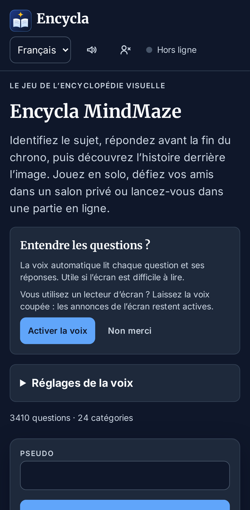 | 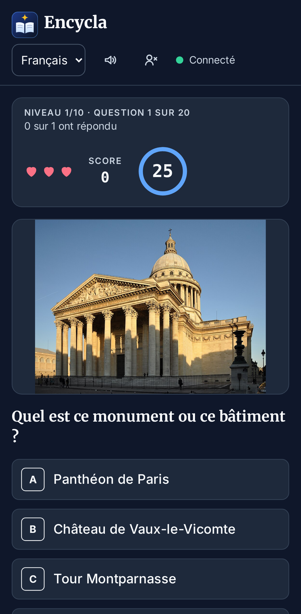 | 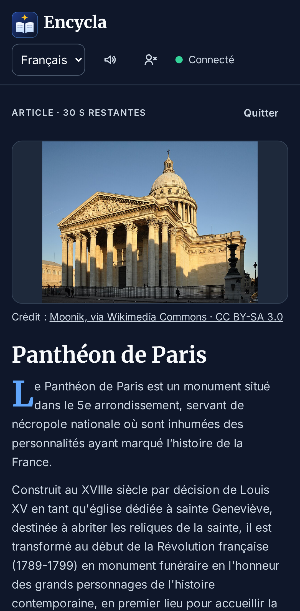 | 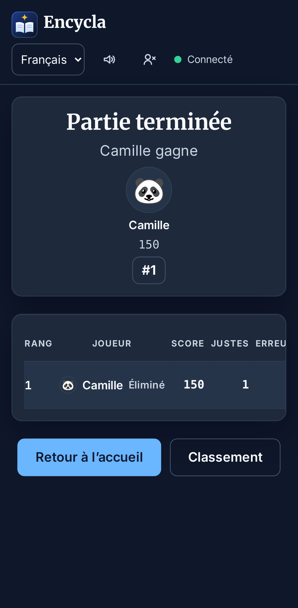 |

**Score** (CLASSIC et SUBJECT) : `points = base + vitesse + série` si la réponse est juste, où `base = 100 × difficulté (1 ; 1,25 ; 1,5) × niveau`, `vitesse` vaut 50 jusqu'à 3 s puis décroît jusqu'à 0 à 13 s, et `série = min(série, 10) × 20`. Une erreur ou l'absence de réponse coûte une vie. **CONTEST** : 1 000 points par bonne réponse, +200 au plus rapide quand les deux ont juste. Détail : [docs/SPECIFICATION.md §7](docs/SPECIFICATION.md).

**Raccourcis** : `A`–`D` ou `1`–`4` pour répondre, `M` pour couper le son (et la voix), `Échap` pour quitter le salon.

**Voix automatique** (accessibilité) : le bouton « voix » de l'en-tête (à côté du son) fait lire à voix haute la question, les quatre réponses avec leur lettre, « 10 secondes », « 5 secondes », puis la bonne réponse, dans la langue des questions. Coupée par défaut ; l'accueil la propose une fois, et « Réglages de la voix » permet de choisir la voix, la vitesse, le volume et la lecture du début de l'article (réglages gardés dans le navigateur). Ce sont les voix de votre navigateur et de votre système, sans service payant : s'il n'y a pas de voix arabe sur l'appareil, un avis le dit et rien n'est lu avec une voix d'une autre langue. Avec un lecteur d'écran, laissez-la coupée : les annonces d'écran restent actives.

## 5. Guide du streamer TikTok

Prérequis côté serveur : `TIKTOK_ENABLED=true` et un `ADMIN_TOKEN` (voir [§8](#8-configuration-env)). Pour un vrai live, le connecteur optionnel `tiktok-live-connector` et un cookie de session d'un **compte TikTok dédié** ([docs/TIKTOK.md](docs/TIKTOK.md)).

### 5.1 Créer la room

1. Ouvrir `https://<votre-domaine>/?mode=admin`.
2. Coller l'`ADMIN_TOKEN` dans « Jeton administrateur », puis **Déverrouiller**. Le jeton reste dans la page et n'est jamais enregistré.
3. Vérifier l'**état du live** : `EN DIRECT` (chat connecté) ou `CHAT HORS LIGNE`, et le live suivi.
4. Saisir le **`@` du live** à suivre (n'importe quel live en cours ; vide = live par défaut `TIKTOK_USERNAME`).
5. Choisir **CLASSIC** ou **SUBJECT** (catégorie, difficulté), la **langue des questions** et le **temps par question** (10 à 30 s).
6. **Créer le salon** : la console affiche le code, le **lien de l'overlay** et le **lien de la console**, avec « Copier » et « Ouvrir ».

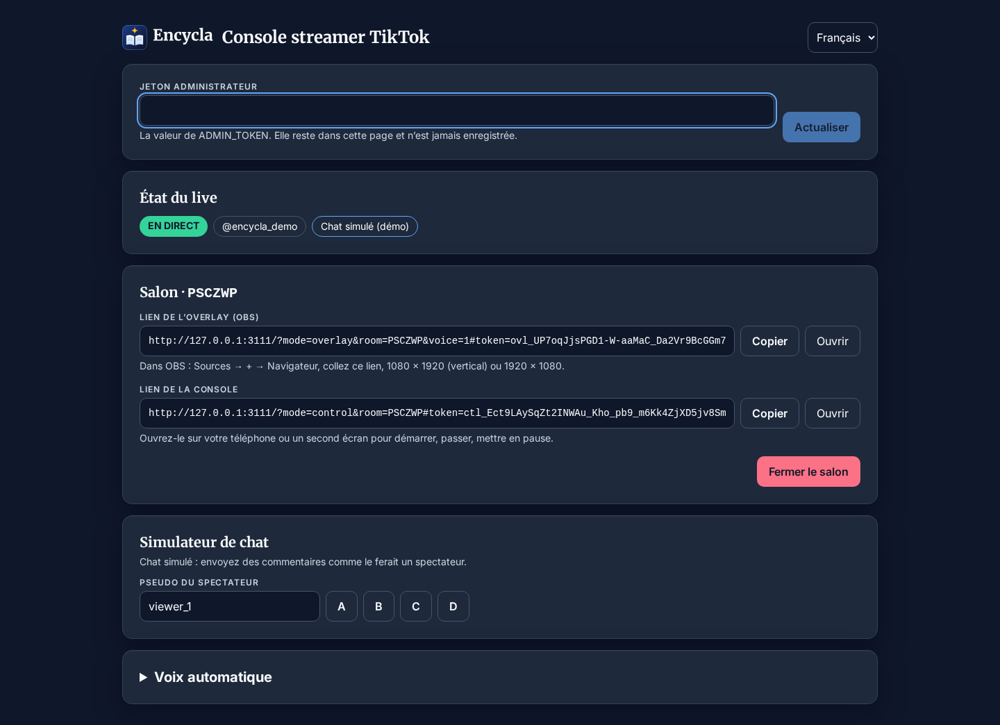

### 5.2 Mettre l'overlay dans OBS

1. OBS → **Sources** → `+` → **Navigateur**.
2. Coller le lien de l'overlay (`/?mode=overlay&room=CODE#token=…`). Le jeton est dans le fragment `#` : il n'est jamais envoyé au serveur HTTP ni écrit dans ses logs.
3. Largeur × hauteur : **1080 × 1920** pour un live vertical, **1920 × 1080** pour un live horizontal.
4. Cocher « Actualiser le navigateur quand la scène devient active » et **« Contrôler l'audio via OBS »** (la voix arrive alors dans le mixeur d'OBS).
5. L'overlay n'a aucun contrôle : il affiche la question, le chronomètre, le top 10, la réponse et l'article.
6. **Voix automatique** : activée par défaut (le lien contient `&voice=1`), elle lit la question, A/B/C/D, le temps restant et la bonne réponse dans la langue des questions. Dans le lobby, l'overlay affiche « Voix : <nom> » ou « Aucune voix dans ce navigateur » : la source Navigateur d'OBS n'a souvent aucune voix. Dans ce cas, laissez la **console** (§5.3, dans Chrome ou Edge) parler et capturez-la avec une source « Capture audio d'application ». Réglages par URL : `voice=0` ou `voice=1`, `rate=0.5` à `2`, `volume=0` à `1`, `article=1`. Détails : [docs/TIKTOK.md](docs/TIKTOK.md#voix-automatique-et-obs-d-115).

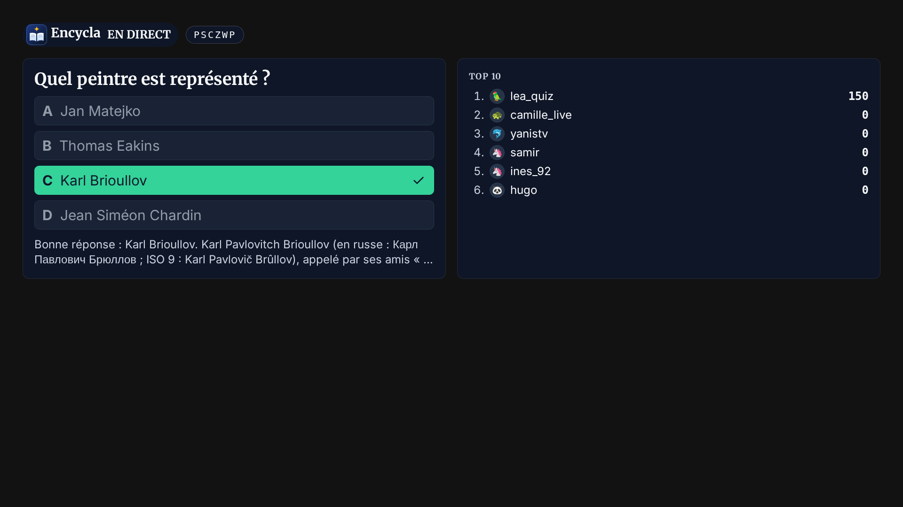

### 5.3 Piloter avec la console

Ouvrir le lien de la console sur un téléphone ou un second écran :

- **Démarrer**, **Pause** / **Reprendre**, **Passer** (question ou article), **Fermer** ;
- **Réponse manuelle** : rechercher un spectateur et répondre `A`–`D` à sa place (si le chat a raté un message) ;
- badge `EN DIRECT` / `CHAT HORS LIGNE` : si le chat se coupe, la room se met en pause au prochain moment sûr ; on reprend à la main ;
- panneau **Voix automatique** (activée par défaut) : voix de la langue des questions, vitesse, volume, « Tester la voix ». Coupez-la ici si OBS capture déjà la voix de l'overlay, pour ne pas l'entendre deux fois.

### 5.4 Ce que font les spectateurs

- Commenter **`A`**, **`B`**, **`C`** ou **`D`** (minuscules acceptées, une `@mention` en tête est ignorée). Le premier commentaire valide inscrit le spectateur et compte comme sa réponse ; les suivants sur la même question sont ignorés.
- Les liens, les commentaires ambigus et les réponses tardives sont ignorés sans bruit. Au-delà de 100 spectateurs, les nouveaux sont ignorés.
- Les spectateurs apparaissent sous leur pseudo TikTok (nettoyé) dans le top 10 et le classement final.

### 5.5 Répéter sans live

Avec `TIKTOK_ADAPTER=fake`, la console streamer affiche « Chat simulé (démo) » et un **simulateur** (pseudo + boutons A/B/C/D). Idéal pour répéter la mise en scène OBS. À ne pas utiliser pour un vrai live.

### 5.6 Fin du live

**Fermer le salon** (console streamer ou console de jeu) révoque les liens overlay/console et libère la place : une seule room TikTok à la fois.

## 6. Langues

- **Français par défaut**, anglais (`en`) et arabe (`ar`, de droite à gauche).
- Choix : sélecteur dans l'en-tête, mémorisé (`localStorage`, clé `encycla.lang.v1`) et dans l'URL (`?lang=ar`, prioritaire). La langue du navigateur n'est pas utilisée.
- Les questions sont dans la **langue du salon** (« Langue des questions ») ; chaque joueur garde son interface dans sa langue. Le matchmaking apparie les joueurs de même langue.
- Traductions (D-108) : nom de l'article Wikipédia ou libellé Wikidata de la langue ; sinon le nom scientifique (êtres vivants) ; sinon le nom d'origine ; sinon la question n'est pas proposée dans cette langue. **Jamais de français par défaut.** Banque actuelle : anglais 2 596 questions, arabe 2 553.
- TikTok : réponses `A`–`D` quelle que soit la langue.

| Arabe, ordinateur | Arabe, mobile |
| --- | --- |
| 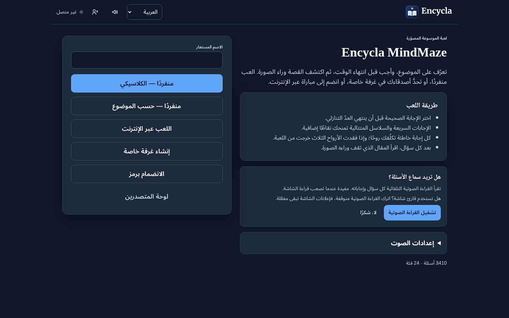 | 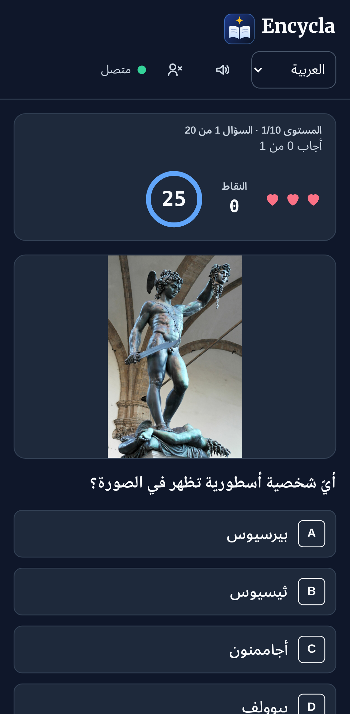 |

## 7. Guide de l'hébergeur / administrateur

### 7.1 Ce qu'il faut

- Un serveur (ou une VM) avec **Docker** ; une seule instance (les rooms sont en mémoire).
- Un **nom de domaine** pointant vers le serveur, ports **80** et **443** ouverts.
- Un **`ADMIN_TOKEN`** : `openssl rand -hex 32`.
- Une destination de **sauvegarde** hors serveur pour la base SQLite.
- Pour TikTok seulement : la décision d'utiliser un client non officiel sous AGPL ([docs/LICENSES.md](docs/LICENSES.md) §3), un compte dédié et son cookie.

### 7.2 Mise en ligne en 5 commandes (Docker + Caddy)

```bash
git clone https://github.com/polbotweb/encycla.git && cd encycla
cp .env.example .env            # puis éditer : NODE_ENV, PUBLIC_ORIGIN, ADMIN_TOKEN, DOMAIN, TRUST_PROXY=true
docker compose --profile proxy up -d --build
curl -s https://<domaine>/api/health   # {"status":"ok",...}
docker compose logs -f encycla
```

Caddy obtient le certificat TLS automatiquement ([deploy/Caddyfile](deploy/Caddyfile)). Le conteneur applicatif est non-root, en système de fichiers en lecture seule, sans capacités, avec healthcheck.

### 7.3 Exploitation courante

| Tâche | Comment |
| --- | --- |
| Santé | `GET /healthz` (le processus répond) et `GET /readyz` (prêt à servir : questions, base, pas en arrêt ; `503` sinon). `GET /api/health` : `ok`, `degraded` (base indisponible, TikTok déconnecté…) ou `error` (`503`). |
| Métriques | `curl -H "Authorization: Bearer $ADMIN_TOKEN" https://<domaine>/metrics` (Prometheus : requêtes, latence, rooms, sockets, file, TikTok, mémoire). Voir `docs/DEPLOYMENT.md` §11. |
| Logs | JSON sur la sortie standard, sans IP persistée, sans cookie ni jeton. Niveau : `LOG_LEVEL` (`debug`, `info`, `warn`, `error`). |
| Fermer une room bloquée | `curl -X POST -H "Authorization: Bearer $ADMIN_TOKEN" https://<domaine>/api/admin/rooms/CODE/close` |
| Sauvegarde | Automatique toutes les `BACKUP_INTERVAL_HOURS` (6 h) dans `BACKUP_DIR`, `BACKUP_KEEP` (28) gardées ; ponctuelle : `pnpm db:backup` (D-119). Copier ensuite le dossier hors du serveur. |
| Restauration | Serveur arrêté : `pnpm db:restore latest --yes` (vérifie la sauvegarde, garde l'ancienne base de côté, supprime `-wal`/`-shm`). |
| Mise à jour | `git pull && docker compose --profile proxy up -d --build` ; migrations et synchronisation des questions au démarrage. |
| Redémarrage | Les rooms en cours sont perdues (matchs marqués `abandoned`) ; le classement est conservé. |
| Activer TikTok | `.env` : `TIKTOK_ENABLED=true`, cookie, puis `WITH_TIKTOK=true docker compose --profile proxy up -d --build`. |

Runbook complet (room bloquée, base verrouillée, mémoire, dérive d'horloge…) : [docs/DEPLOYMENT.md §13](docs/DEPLOYMENT.md).

## 8. Configuration (`.env`)

Copier [`.env.example`](.env.example) en `.env` (jamais commité). Le serveur **refuse de démarrer** en production si une valeur requise manque ou est faible, en listant les problèmes sans afficher les secrets.

| Variable | Défaut | Rôle |
| --- | --- | --- |
| `NODE_ENV` | `development` | `production` active toutes les validations. |
| `PORT` | `3000` | Port HTTP et Socket.io. |
| `PUBLIC_ORIGIN` | — | Origine publique exacte (`https://hôte`, sans slash) ; requise en production ; sert aussi à `og:image`. |
| `DATABASE_PATH` | `data/encycla.db` | Base SQLite (repli mémoire si indisponible). |
| `LOG_LEVEL` | `info` | `debug`, `info`, `warn`, `error`. |
| `IMAGE_CACHE_DIR` | `data/image-cache` | Cache disque des images Commons du proxy `/img` ; vide = mémoire seule. |
| `IMAGE_CACHE_MAX_MB` | `512` | Taille maximale de ce cache. |
| `BACKUP_DIR` | `backups/` à côté de la base | Sauvegardes SQLite automatiques à chaud (D-119). Vide : désactivées. |
| `BACKUP_INTERVAL_HOURS` | `6` | Intervalle des sauvegardes (`0` : désactivé). |
| `BACKUP_KEEP` | `28` | Sauvegardes gardées (rotation). Restauration : `pnpm db:restore`. |
| `IMAGE_TOKEN_SECRET` | *(généré)* | Clé des liens `/img/…` (≥ 32 caractères). Vide : générée une fois dans le dossier de la base (`data/image-token.secret`, mode 600), pour que les images des parties en cours survivent à un redémarrage. **Secret.** |
| `ADMIN_TOKEN` | — | Routes admin et console streamer ; requis en production, 32 caractères aléatoires minimum. |
| `TRUST_PROXY` | `false` | `true` (un proxy) ou nombre de proxys devant le serveur. |
| `RATE_LIMIT` | `on` | `off` pour les tests de charge et e2e ; refusé en production. |
| `TIKTOK_ENABLED` | `false` | Active le mode TikTok. |
| `TIKTOK_ADAPTER` | `live` | `live` (connecteur réel) ou `fake` (chat simulé, démo et tests). |
| `TIKTOK_USERNAME` | — | Live suivi par défaut (facultatif : chaque room peut nommer son live). |
| `TIKTOK_SESSION_COOKIE` | — | Cookie du compte dédié (`sessionid=…; tt-target-idc=…`) ; requis avec `live`. |
| `TIKTOK_SIGN_API_KEY` | — | Clé Euler Stream facultative (quotas du service de signature). |
| `GEMINI_API_KEY` | — | Scripts de contenu hors ligne uniquement ; jamais dans le conteneur de jeu. |
| `DOMAIN` | — | Domaine servi par Caddy (`docker compose --profile proxy`). |

Variables de build Docker : `WITH_TIKTOK=true` garde le connecteur AGPL dans l'image (absent par défaut). Toutes les règles : [docs/DEPLOYMENT.md §6.1](docs/DEPLOYMENT.md).

## 9. Déploiement

### 9.1 Docker seul

```bash
docker build -t encycla .                             # sans le connecteur TikTok
docker build --build-arg WITH_TIKTOK=true -t encycla . # avec
docker run -d --env-file .env -p 127.0.0.1:3000:3000 \
  -v encycla-db:/app/data/db -e DATABASE_PATH=/app/data/db/encycla.db encycla
```

### 9.2 Docker Compose + Caddy

`docker compose up -d --build` sert l'application sur `127.0.0.1:3000` ; `--profile proxy` ajoute Caddy en HTTPS sur 80/443 (variable `DOMAIN`). Volumes : base SQLite (à sauvegarder) et cache d'images (jetable).

### 9.3 Sans Docker (Node)

```bash
pnpm install --frozen-lockfile && pnpm run build
NODE_ENV=production PUBLIC_ORIGIN=https://<domaine> ADMIN_TOKEN=<64 hex> TRUST_PROXY=true node dist/server/index.js
```

Derrière Caddy ou Nginx (WebSocket à relayer pour `/socket.io`). Exemples dans [docs/DEPLOYMENT.md §6.3](docs/DEPLOYMENT.md).

### 9.4 Plateforme (PaaS)

Toute plateforme qui exécute un `Dockerfile` convient si elle offre : **une seule instance** (pas d'auto-scaling horizontal : rooms et rate limiting sont en mémoire), un **volume persistant** pour `DATABASE_PATH`, les **WebSockets**, et les variables du §8 (`PUBLIC_ORIGIN` = l'URL https publique, `TRUST_PROXY=true` derrière le routeur de la plateforme). Healthcheck : `GET /api/health`.

## 10. Sécurité et anti-triche

- **Autorité serveur** : le client n'envoie que des intentions (`ANSWER` avec l'index choisi). Score, temps de réponse (horloge serveur), vies et classement sont calculés côté serveur ; le client n'a aucune règle de jeu.
- **Aucune fuite de réponse** : `correctIndex` n'est jamais envoyé avant `REVEAL` ; les images passent par `/img/<jeton>` (jeton éphémère par manche), sans nom de fichier ni crédit avant la révélation, métadonnées EXIF retirées.
- **Une réponse par question**, verrouillée ; doublons, réponses tardives et jetons de phase périmés refusés.
- **Sessions** : jetons aléatoires, hachés en base ; un `playerId` fourni par le client n'est jamais cru.
- **Overlay / console** : jetons propres à une room, dans le fragment d'URL, révoqués à la fermeture ; l'overlay est en lecture seule.
- **Entrées** : validation Zod de toutes les requêtes et de tous les événements ; pseudos et pseudos TikTok normalisés.
- **Rate limiting** par route, adapté aux IP partagées : `/api` compté par session (120/min) avec un plafond par IP (1 200/min), admin strict (30/min/IP), images souples (1 200/min/IP), statiques et `/api/health` non limités, Socket.io par joueur et par connexion (détail : `docs/SECURITY.md` §8, D-118).
- **En-têtes** : CSP stricte (`default-src 'self'`, pas de `unsafe-inline` ni `unsafe-eval`), HSTS, Permissions-Policy ; aucun CDN ; aucun `dangerouslySetInnerHTML`.
- **Secrets** : jamais dans le dépôt (gitleaks en CI), jamais préfixés `VITE_`, jamais dans les logs.

Modèle de menace complet : [docs/SECURITY.md](docs/SECURITY.md).

## 11. Tutoriel développeur

### 11.1 Prérequis et installation

- Node.js **22**, pnpm **10.28** (`corepack enable`), Git.

```bash
git clone https://github.com/polbotweb/encycla.git && cd encycla
pnpm install --frozen-lockfile
cp .env.example .env
pnpm run dev            # client http://localhost:5173 (proxy /api, /socket.io) + serveur http://localhost:3000
```

Migrations et synchronisation des questions s'appliquent au démarrage du serveur.

### 11.2 Scripts

| Script | Rôle |
| --- | --- |
| `pnpm dev` | Client Vite + serveur `tsx watch`. |
| `pnpm build` | Client (Vite, assets précompressés) + serveur (bundle esbuild `dist/server/index.js`). |
| `pnpm start` | Serveur de production depuis `dist/`. |
| `pnpm lint` / `pnpm typecheck` | ESLint ; TypeScript strict (client, serveur, tests). |
| `pnpm format` / `pnpm format:check` | Prettier. |
| `pnpm test` / `pnpm test:coverage` | Vitest (unitaires, intégration Socket.io, jsdom + axe) avec seuils de couverture. |
| `pnpm test:e2e` | Playwright, tous les projets (bureau, mobiles, TikTok). |
| `pnpm test:e2e:desktop` / `pnpm test:e2e:mobile` | Bureau + TikTok ; Pixel 7 + iPhone 14. |
| `pnpm test:load` | Charge : 25 duels CONTEST (50 sockets) contre `BASE_URL`. |
| `pnpm docs:screenshots` | Régénère `docs/screenshots/` depuis l'application construite. |
| `pnpm data:wikipedia` | (Re)génère la banque depuis Wikipédia/Commons/Wikidata (`--offline` : depuis le cache). |
| `pnpm data:validate` | Valide `data/questions.json` et affiche les statistiques par langue. |
| `pnpm data:import` / `pnpm db:migrate` | Import JSON → SQLite ; migrations. |
| `pnpm brand` | Régénère logo, favicons, icônes et images sociales depuis le code. |

### 11.3 Architecture

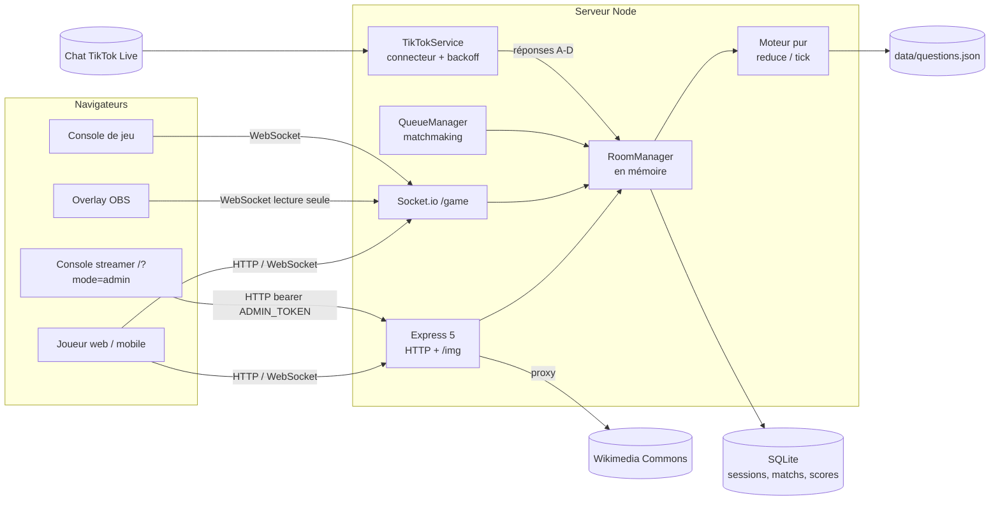

Une partie est un salon ; le `RoomManager` applique les événements au moteur pur (`server/game/engine.ts`), exécute ses effets (persistance, minuteries) et diffuse un instantané `ROOM_STATE` personnalisé à chaque participant.

### 11.4 Structure des dossiers

```text
client/                 React 19 + Zustand
  views/                Accueil, lobby, question, révélation, article, résultats, classement,
                        matchmaking, overlay, console de jeu, console streamer (AdminView)
  components/           Shell, modales, boutons, logo, images…
  i18n/                 fr.ts (référence), en.ts, ar.ts, sélecteur
  lib/ store/ styles/   API, temps réel, stores, tokens CSS
server/
  game/                 Moteur pur : engine, scoring, state-machine, questions
  rooms/ matchmaking/   RoomManager, codes ; QueueManager
  realtime/             Passerelle Socket.io, charges utiles
  http/                 Routes (sessions, jeu, admin, santé, social)
  images/               Proxy /img, cache, jetons
  persistence/ db/      SQLite (better-sqlite3), repli mémoire, migrations
  security/             Jetons, jetons de room, rate limiting
  tiktok/               Parseur, connecteur, adaptateurs réel/simulé, service, câblage
shared/                 Types, schémas Zod, protocole, langues
data/                   questions.json (versionné), base et caches (ignorés)
scripts/                Générateur Wikipédia, validation, import, marque, charge, e2e
tests/                  unitaires, intégration, client, données, e2e Playwright
docs/                   Documentation de référence et captures
deploy/                 Caddyfile
```

### 11.5 Protocole

- **HTTP** (`/api`) : `POST /sessions`, `GET|PATCH /me`, `GET /config`, `POST /rooms`, `POST /solo`, `POST|DELETE /queue`, `GET /leaderboard`, `GET /health` ; admin : `POST /tiktok/rooms`, `GET /admin/tiktok`, `POST /admin/tiktok/chat` (chat simulé), `POST /admin/rooms/:code/close`.
- **Socket.io** (`/game`) — client → serveur : `ROOM_JOIN`, `ROOM_LEAVE`, `LOBBY_READY`, `GAME_START`, `ANSWER`, `CONTINUE`, `HOST_PAUSE`, `HOST_RESUME`, `HOST_SKIP`, `HOST_MANUAL_ANSWER`, `HOST_CLOSE`, `SMALL_ROOM_VOTE` ; serveur → client : `SESSION_READY`, `ROOM_STATE`, `PLAYER_LOCKED`, `TIMER_SYNC`, `MATCH_FOUND`, `SMALL_ROOM_PROPOSAL`, `QUEUE_STATE`, `CONTROL_READY`, `ROOM_CLOSED`, `SESSION_REPLACED`, `ERROR`.
- Phases : `LOBBY → COUNTDOWN → QUESTION → REVEAL → ARTICLE → (LEVEL_COMPLETE) → … → MATCH_OVER`, plus `PAUSED` et `CLOSED`.

Contrat complet, charges utiles et codes d'erreur : [docs/PROTOCOL.md](docs/PROTOCOL.md).

### 11.6 Modèle de données

- **SQLite** : `players`, `player_sessions` (jetons hachés), `matches`, `scores`, `questions`, `questions_pending`.
- **Questions** (`data/questions.json`) : `id`, `category`, `subject`, `questionText`, `options[4]`, `correctIndex`, `explanation`, `articleTitle`, `articleBody` (texte brut), `image` (`url`, `alt`, `author`, `license`, `credit`, `sourceUrl`), `source` (permalien `oldid`, licence), `translations.en|ar` avec `provenance`, ou `unavailable.<langue>`.

Détail : [docs/DATA-MODEL.md](docs/DATA-MODEL.md).

### 11.7 Ajouter une langue

1. `shared/languages.ts` : ajouter le code à `LANGUAGES` et `TRANSLATED_LANGUAGES`, sa direction et son nom.
2. `client/i18n/<code>.ts` : traduire toutes les clés de `fr.ts` (le typage refuse une clé manquante) et l'enregistrer dans `client/i18n/index.ts`.
3. Polices : ajouter une police OFL auto-hébergée si l'écriture l'exige (jamais de CDN).
4. Contenu : `pnpm data:wikipedia` génère `translations.<code>` depuis la Wikipédia et Wikidata de cette langue, puis `pnpm data:validate`.
5. Tests : ajouter la langue aux listes des tests d'i18n et des e2e (`tests/e2e/play-modes.spec.ts`).

### 11.8 Conventions

Jamais de règle de jeu dans le client ; un test pour chaque comportement ; une décision produit = une entrée dans [docs/DECISIONS.md](docs/DECISIONS.md) ; pas de nouvelle dépendance sans justification ; pas de HTML dans les articles.

## 12. Guide du rédacteur de contenu

Le contenu n'est **jamais écrit à la main** : seuls les **titres d'articles** de Wikipédia en français sont choisis. Tout le reste (réponse, explication, article, image, auteur, licence, révision, traductions) vient de Wikipédia, Wikidata et Wikimedia Commons.

### 12.1 Ajouter des questions à une catégorie

1. Ouvrir le fichier de graines de la catégorie dans `scripts/wikimedia/seeds/` (`nature.ts`, `world.ts`, `culture.ts`, `society.ts`).
2. Ajouter des titres d'articles **exacts** (séparés par `;`) dans le groupe adapté (`group`, `question`, `alt`). L'`alt` ne doit jamais contenir la réponse.
3. Lancer `pnpm data:wikipedia` (en ligne : API polie, cache dans `data/cache/`).
4. Lire `data/sources/report.json` : titres écartés (homonymie, image non libre, réponse introuvable…) et paires de distracteurs proches à relire.
5. `pnpm data:validate`, puis `pnpm test`, puis commit de `data/questions.json`, `data/sources/report.json` et `CREDITS.md`.

### 12.2 Ajouter une catégorie

1. `shared/schemas.ts` : ajouter la valeur à `CATEGORY_VALUES`.
2. `client/i18n/fr.ts`, `en.ts`, `ar.ts` : clé `category.<Valeur>`.
3. `scripts/wikimedia/seeds/` : créer ses groupes et les enregistrer dans `seeds/index.ts`.
4. Générer et valider. SUBJECT n'est ouvert qu'à partir de **100 questions** dans une langue (viser 115+).

### 12.3 Règles éditoriales

- Licences d'images acceptées : CC0, domaine public, CC BY, CC BY-SA ; le reste est écarté automatiquement.
- Distracteurs : de vrais sujets du même type, de préférence du même groupe, jamais la même entité.
- Traductions : nom réel dans la langue, sinon nom scientifique, sinon nom d'origine, sinon pas de question dans cette langue ; jamais de français de secours.
- Tout ce qui est douteux est écarté plutôt que corrigé à la main.

Détails : [docs/DATA-MODEL.md](docs/DATA-MODEL.md), [docs/DECISIONS.md](docs/DECISIONS.md) (D-80 à D-112).

## 13. Tests et CI

| Niveau | Outil | Contenu |
| --- | --- | --- |
| Unitaires | Vitest | Moteur (scoring, phases, vies, séries), parseur TikTok, connecteur, câblage de l'adaptateur réel avec un module simulé, formes de libellés. |
| Intégration | Vitest + Socket.io | CONTEST complet, solo, file publique, vote petit salon, reconnexion, room TikTok à 100 spectateurs, n'importe quel live, chat simulé. |
| Client | Vitest + jsdom + axe | Vues, console streamer, i18n, accessibilité. |
| E2E bureau | Playwright `chromium` | Solo jusqu'aux résultats, salon privé, matchmaking en fr/en/ar, TikTok désactivé sans lien cassé, images, RTL, axe. |
| E2E mobile | Playwright `mobile-pixel`, `mobile-iphone` | Les mêmes parcours au toucher, sans défilement horizontal. |
| E2E TikTok | Playwright `tiktok` | Console streamer → overlay 1920×1080 + console → spectateurs A/B/C/D → 20 questions → classement final → fermeture. |
| Charge | `pnpm test:load` | 25 duels simultanés, latences p50/p95. |

Les e2e tournent contre le **serveur construit** (`pnpm build`), un serveur web sans TikTok et un serveur `TIKTOK_ADAPTER=fake`. Contre un déploiement existant : `E2E_BASE_URL=https://… E2E_TIKTOK_BASE_URL=https://… E2E_ADMIN_TOKEN=… pnpm exec playwright test`. Une passe « production » locale (`NODE_ENV=production`, https via `scripts/e2e/tls-proxy.mjs`) est décrite dans [docs/TESTING.md](docs/TESTING.md).

```bash
pnpm lint && pnpm typecheck && pnpm format:check && pnpm data:validate && pnpm test:coverage && pnpm build
pnpm test:e2e
RATE_LIMIT=off pnpm start &   # puis
BASE_URL=http://localhost:3000 pnpm test:load
```

**CI GitHub Actions** ([.github/workflows/ci.yml](.github/workflows/ci.yml)) : `secrets` (gitleaks), `verify` (format, lint, types, données, tests avec couverture, audit, build), `e2e` (bureau + TikTok), `e2e-mobile` (Pixel 7 + iPhone 14), `docker` (build de l'image).

## 14. FAQ et dépannage

**Le serveur refuse de démarrer (« Invalid configuration »).** Lire la liste affichée : en production il faut `ADMIN_TOKEN` (32+ caractères aléatoires), `PUBLIC_ORIGIN` en `https://`, pas de `RATE_LIMIT=off` ; avec TikTok réel, `TIKTOK_SESSION_COOKIE`.

**« Déconnecté » en haut à droite, rien ne se passe.** Le WebSocket ne passe pas : vérifier que le proxy relaie `/socket.io` (upgrade), que `PUBLIC_ORIGIN` est exactement l'URL du site, et `TRUST_PROXY=true` derrière un proxy.

**Les images ne s'affichent pas.** Le serveur doit joindre `upload.wikimedia.org` (sortie HTTPS). Le cache `IMAGE_CACHE_DIR` évite de retélécharger.

**Trop de requêtes (429).** Les limites sont dans `server/security/limits.ts` (`docs/SECURITY.md` §8). Un joueur connecté est compté sur sa session, donc une classe derrière une même IP passe ; derrière un proxy, sans `TRUST_PROXY`, tous les joueurs partagent quand même l'IP du proxy pour les budgets par IP.

**La catégorie est « Bientôt disponible ».** Moins de 100 questions dans la langue choisie : ajouter des titres ([§12](#12-guide-du-rédacteur-de-contenu)).

**TikTok : `CHAT HORS LIGNE`.** Vérifier que le live est en cours, le `@`, le cookie (compte dédié), et que l'image a été construite avec `WITH_TIKTOK=true`. Le connecteur réessaie seul (1 s → 30 s) ; reprendre la room depuis la console.

**TikTok : « Un salon TikTok est déjà ouvert ».** Une seule room TikTok à la fois : la fermer depuis la console streamer.

**Un joueur a rechargé la page.** Il retrouve sa partie (reconnexion par session) ; après la fin, « Retour à l'accueil » le sort du salon terminé.

**Comment tester TikTok sans compte ?** `TIKTOK_ENABLED=true TIKTOK_ADAPTER=fake ADMIN_TOKEN=…` puis `/?mode=admin`.

## 15. Contribuer

1. Forker, créer une branche, `pnpm install`.
2. Lire les documents de référence concernés (règles : SPECIFICATION ; contrat : PROTOCOL ; décisions : DECISIONS).
3. Écrire le test d'abord ou en même temps ; garder les règles dans le serveur.
4. Vérifier : `pnpm lint && pnpm typecheck && pnpm format:check && pnpm test:coverage && pnpm test:e2e`.
5. Si l'interface change : `pnpm docs:screenshots` et mettre à jour ce README.
6. Ouvrir une pull request décrivant le comportement et les tests. Jamais de secret, jamais de contenu inventé.

## 16. Documentation détaillée

| Document | Contenu |
| --- | --- |
| [docs/SPECIFICATION.md](docs/SPECIFICATION.md) | Règles, modes, phases, scores, matchmaking, TikTok. |
| [docs/PROTOCOL.md](docs/PROTOCOL.md) | Contrat HTTP et Socket.io, erreurs, séquences. |
| [docs/DATA-MODEL.md](docs/DATA-MODEL.md) | Schéma SQLite, format des questions, traductions. |
| [docs/TIKTOK.md](docs/TIKTOK.md) | Mode TikTok, n'importe quel live, chat simulé, connecteur réel, checklist de live. |
| [docs/DEPLOYMENT.md](docs/DEPLOYMENT.md) | Local, production, Docker, TLS, sauvegardes, supervision, runbook. |
| [docs/SECURITY.md](docs/SECURITY.md) | Menaces, authentification, CSP, secrets, vie privée. |
| [docs/TESTING.md](docs/TESTING.md) | Pyramide de tests, cas obligatoires, couverture, CI. |
| [docs/UI-UX.md](docs/UI-UX.md) | Écrans, tokens, accessibilité, overlay, console, RTL. |
| [docs/ADR.md](docs/ADR.md) | Décisions d'architecture. |
| [docs/DECISIONS.md](docs/DECISIONS.md) | 114 décisions explicites et dettes assumées. |
| [docs/IMPLEMENTATION-PLAN.md](docs/IMPLEMENTATION-PLAN.md) | Phases et critères de sortie. |
| [docs/LICENSES.md](docs/LICENSES.md) | Licences du code, du contenu, des polices et du connecteur TikTok. |

Limites assumées en v1 : une seule instance, rooms en mémoire (les rooms web sont restaurées après un redémarrage de moins de 10 minutes, D-117 ; pas les rooms TikTok), rate limiting en mémoire, connecteur TikTok non officiel. Ce qui reste à faire hors code : valider le connecteur réel sur un compte secondaire (1 h, 20 spectateurs) et les tests d'accessibilité manuels (NVDA, VoiceOver).

## 17. Licences et crédits

- **Code** : [MIT](LICENSE), © 2026 Ishaq74 et les contributeurs d'Encycla.
- **Questions et articles** : Wikipédia (fr, en, ar) sous **CC BY-SA 4.0**, libellés Wikidata sous CC0 ; permalien de révision par question et par langue ([CREDITS.md](CREDITS.md)).
- **Images** : Wikimedia Commons, licence propre à chaque fichier (CC0, domaine public, CC BY, CC BY-SA), crédit affiché sous chaque image et listé dans `CREDITS.md`.
- **Marque Encycla** : logo et icônes originaux générés par `pnpm brand` (`scripts/brand/build-brand.ts`).
- **Polices** : Merriweather, Inter, Noto Sans Arabic, Noto Naskh Arabic (SIL Open Font License).
- **Connecteur TikTok** (optionnel) : `tiktok-live-connector`, **AGPL-3.0-only**, absent de l'image par défaut.
- **Sons** : synthétisés en WebAudio, aucun fichier audio.

Détail et obligations : [docs/LICENSES.md](docs/LICENSES.md).
